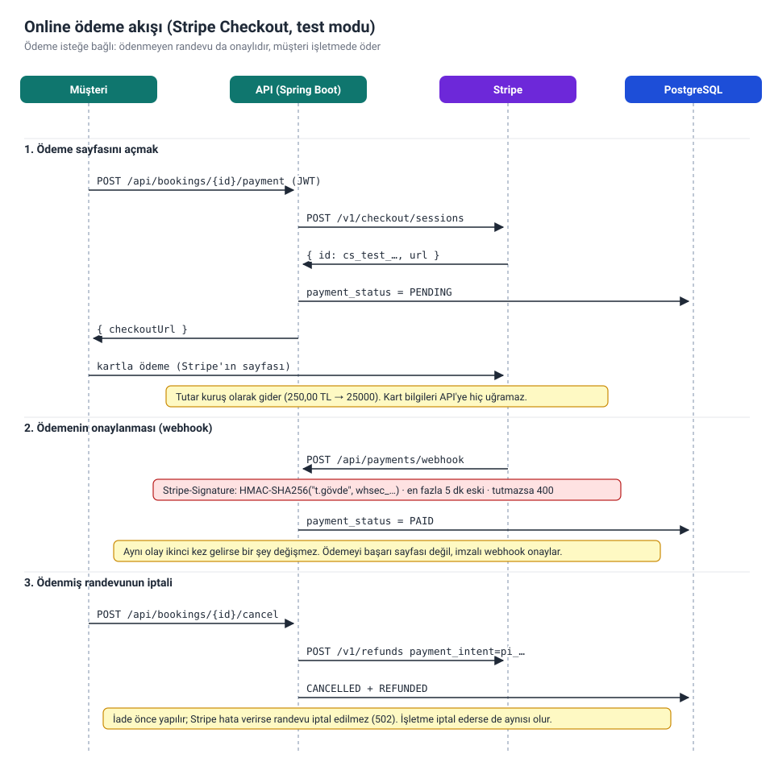

# randevu-api

[](https://github.com/Semiheren05/randevu-api/actions/workflows/ci.yml)


[](LICENSE)

Kuaför, klinik, güzellik salonu, özel ders gibi işletmeler için çok işletmeli bir **online randevu sistemi** backend'i. İşletmeler hizmetlerini, çalışanlarını, çalışma saatlerini ve tatil günlerini giriyor. Müşteriler boş saatleri görüp randevu alıyor, isterse online ödüyor, randevudan bir gün önce hatırlatma alıyor ve sonrasında puan verip yorum bırakıyor.

Bu projeyi freelance platformlarındaki (Upwork, Freelancer) randevu ve rezervasyon sistemi ilanlarında en sık istenen özelliklere göre tasarladım: dinamik boş saatler, hizmet veren yönetimi, otomatik onay ve hatırlatma e-postaları, online ödeme, müşteri yorumları ve işletme paneli istatistikleri.

## Teknolojiler

| Alan | Seçim |
|---|---|
| Dil / framework | Java 21, Spring Boot 3.5 |
| Güvenlik | Spring Security, durumsuz JWT, BCrypt, rol tabanlı yetkilendirme (`CUSTOMER`, `OWNER`) |
| Veritabanı | PostgreSQL 17, Spring Data JPA / Hibernate, Flyway, `EXCLUDE` kısıtı (btree_gist) |
| E-posta | Spring Mail (SMTP), olay tabanlı ve asenkron bildirim, `@Scheduled` ile hatırlatma |
| Ödeme | Stripe Checkout (test modu), `RestClient` ile REST çağrıları, HMAC-SHA256 imzalı webhook |
| API dokümantasyonu | OpenAPI 3 / Swagger UI (springdoc) |
| Test | JUnit 5, Mockito, AssertJ, Testcontainers |
| Dağıtım | Docker (multi-stage), Docker Compose, GitHub Actions |

## Özellikler

- **Çok işletmeli**: her işletme sahibi kendi işletmelerini yönetir; başkasının işletmesi ona hiç yokmuş gibi görünür (404)
- **Hizmetler ve çalışma saatleri**: süre ve fiyatıyla hizmetler, haftanın her günü için açılış/kapanış saati
- **Çalışanlar**: her çalışanın kendi takvimi var, iki kuaförlü bir salon aynı saate iki randevu alabilir. Çalışana hangi hizmetleri yaptığı atanabilir (boş bırakılırsa hepsini yapar). Müşteri çalışan seçebilir. Çalışanı olmayan işletme tek takvimle çalışmaya devam eder
- **Çalışana özel çalışma saatleri**: yarı zamanlı biri yalnızca kendi günlerinde ve saatlerinde randevu alır. Geçerli olan, çalışanın saatleriyle işletmenin açık olduğu saatlerin kesişimi; saat girilmeyen çalışan işletmenin saatlerini kullanır
- **Dengeli dağıtım**: müşteri çalışan seçmezse, o saatte boş olanlar arasından **o gün en az dolu süresi olan** çalışan atanır (randevu sayısı değil dakika sayılır; eşitlikte ilk eklenen). Böylece iş tek kişide birikmez
- **Dinamik boş saatler**: çalışma saatlerinden onaylı randevular ve geçmiş saatler çıkarılır, kalanlar 15 dakikalık adımlarla sunulur. Çalışanlı işletmede bir saat, o hizmeti yapan çalışanlardan en az biri boşsa listelenir
- **Çifte rezervasyon koruması**: iki aşamalı. Önce uygulama boş saatleri kontrol eder; aynı anda gelen iki istek bu kontrolü birlikte geçse bile PostgreSQL'in `EXCLUDE` kısıtları (çalışan bazında ya da çalışanı olmayan işletmede işletme bazında) yalnızca birini kabul eder. Çalışan seçilmemişse geri çevrilen istek bir kez daha denenir ve boş olan diğer çalışana gider; kimse boş değilse `409` alır
- **Tatil ve izin günleri**: işletme sahibi tek seferlik kapalı günler girer (bayram, tadilat, yıllık izin). Bütün işletme kapalıysa o gün boş saat listelenmez ve yanıttaki `closedReason` sebebini gösterir. Sadece bir çalışan izinliyse o gün onun randevuları diğer çalışanlara gider. Kapatılmak istenen günlerde onaylı randevu varsa kapanış eklenmez (`409`); önce o randevuların iptal edilmesi gerekir
- **İptal kuralları**: müşteri randevudan 2 saat öncesine kadar iptal edebilir; işletme sahibi yaklaşan her randevuyu iptal edebilir
- **E-posta bildirimleri**: randevu alındığında ve iptal edildiğinde müşteriye ve işletmeye Türkçe e-posta gider. Bildirim, kayıt kesinleştikten sonra ayrı bir thread'de gönderilir; mail sunucusu çökse bile randevu etkilenmez
- **Hatırlatma e-postası**: `@Scheduled` görevi 15 dakikada bir, önümüzdeki 24 saat içinde başlayacak randevuları bulup müşteriye hatırlatma gönderir. `reminder_sent_at` sütunu sayesinde aynı randevuya iki kez gitmez. Son 24 saat içinde alınmış randevulara gönderilmez, çünkü onay e-postası zaten yeni gelmiştir
- **Online ödeme (isteğe bağlı)**: Stripe Checkout, test modunda. Müşteri Stripe'ın ödeme sayfasına yönlendirilir; kart bilgisi API'ye hiç uğramaz. Ödemeyi imzası doğrulanan webhook onaylar, aynı olay ikinci kez gelirse bir şey değişmez. Ödenmiş randevu iptal edilirse ücret otomatik iade edilir; iade başarısız olursa randevu da iptal edilmez. Ödeme kapalıyken (`PAYMENT_PROVIDER=none`) müşteri işletmede öder
- **Yorumlar ve puanlama**: müşteri gerçekleşmiş her randevusu için bir kez 1–5 puan ve yorum bırakabilir. İşletmenin sayfasında ortalama puan (tek ondalık), yorum sayısı ve en yeni yorumlar görünür. Yorumda müşterinin sadece adı gösterilir, e-postası asla
- **İstatistikler**: seçilen dönemde onaylı ve iptal edilen randevu sayısı, gelir, en çok tercih edilen hizmetler ve çalışan başına randevu sayısı
- **Saat dilimi desteği**: zamanlar veritabanında UTC saklanır, API'de işletmenin kendi saat diliminde gösterilir
- **Tutarlı hata yanıtları**: her hata, 401/403 dahil, [RFC 9457](https://www.rfc-editor.org/rfc/rfc9457) problem-detail JSON'u olarak döner

## Nasıl çalışıyor?

### Veritabanı şeması


`bookings` tablosundaki `EXCLUDE` kısıtları projenin en önemli parçası. Aynı çalışanın iki onaylı randevusunun zaman aralıkları (`tstzrange`) kesişirse veritabanı ikinci kaydı reddediyor; çalışanı olmayan işletmelerde aynı kural işletmenin kendisi için geçerli. İki kısıt `WHERE staff_id IS (NOT) NULL` ile birbirinden ayrılıyor. Bu yüzden "önce kontrol et, sonra kaydet" arasındaki küçük boşlukta bile çifte rezervasyon oluşamıyor. `'[)'` sınırları sayesinde 10:00–10:30 ve 10:30–11:00 randevuları çakışmış sayılmıyor.

`closures` tablosunda `staff_id` boşsa bütün işletme kapalı demek, doluysa sadece o çalışan izinli. `reviews.booking_id` benzersiz olduğu için bir randevuya yalnızca bir yorum yazılabiliyor.

### Randevu alma akışı


### Online ödeme akışı



Ödeme sağlayıcısı `PaymentGateway` arayüzünün arkasında duruyor. iyzico gibi başka bir sağlayıcı eklemek için yeni bir sınıf yazmak yetiyor; randevu kodu değişmiyor. Stripe SDK'sı yerine Stripe'ın REST API'si `RestClient` ile doğrudan çağrılıyor, webhook imzası da elle doğrulanıyor (HMAC-SHA256, sabit zamanlı karşılaştırma, 5 dakika tolerans). Testlerde Stripe `MockRestServiceServer` ile taklit ediliyor, entegrasyon testlerinde ise imzalı webhook'ları gerçekten doğrulayan sahte bir sağlayıcı (`fake`) kullanılıyor.

### Boş saat hesabı


Diyagram tek bir takvimi gösteriyor. Çalışanlı işletmede aynı hesap her çalışan için, çalışanın kendi saatleri işletme saatlerine kırpılarak ayrı yapılıyor. Çalışanlar o günkü dolu sürelerine göre sıralanıp sırayla işlendiği için her boş saat, o saatte boş olanların en az dolu olanına düşüyor. Hesap `AvailabilityCalculator` içinde, veritabanına ve saate dokunmayan saf bir fonksiyon. Bu sayede her kural (geçmiş saatler, çakışmalar, kapanışa sığmayan hizmetler, gece yarısını aşan saatler) birim testleriyle tek tek denenebiliyor.

## Çalıştırma

### Docker Compose ile (API + PostgreSQL)

```bash
cp .env.example .env
# .env içinde JWT_SECRET'ı ayarla, örneğin: openssl rand -base64 48
docker compose up --build
```

API `http://localhost:8080` adresinde, Swagger UI `http://localhost:8080/swagger-ui.html` adresinde açılır.

### IDE'den yerel olarak

```bash
docker compose up -d db     # sadece veritabanı
mvn spring-boot:run
```

`JWT_SECRET` ayarlanmazsa `application.yml` içindeki sadece geliştirme amaçlı anahtar kullanılır. Yerel geliştirme dışında buna asla güvenme.

### Ayarlar

| Değişken | Varsayılan | Amaç |
|---|---|---|
| `DB_URL` | `jdbc:postgresql://localhost:5432/randevuapi` | JDBC adresi |
| `DB_USERNAME` / `DB_PASSWORD` | `randevuapi` / `randevuapi` | Veritabanı bilgileri |
| `JWT_SECRET` | geliştirme değeri | Base64 HMAC anahtarı, en az 32 bayt |
| `JWT_EXPIRATION` | `1h` | Token geçerlilik süresi |
| `CORS_ALLOWED_ORIGINS` | `http://localhost:5500,http://localhost:3000` | İzinli tarayıcı adresleri |
| `BOOKING_SLOT_STEP` | `15m` | Boş saatlerin aralığı |
| `BOOKING_CANCELLATION_NOTICE` | `2h` | Müşterinin en geç ne kadar önce iptal edebileceği |
| `BOOKING_MAX_DAYS_AHEAD` | `60` | En fazla kaç gün sonrasına randevu alınabileceği |
| `SPRING_MAIL_HOST` / `SPRING_MAIL_PORT` | boş / `587` | SMTP sunucusu; host boşsa e-posta gönderilmez |
| `SPRING_MAIL_USERNAME` / `SPRING_MAIL_PASSWORD` | boş | SMTP giriş bilgileri |
| `NOTIFICATION_MAIL_FROM` | boş | Bildirimlerin gönderen adresi |
| `BOOKING_REMINDERS_ENABLED` | `true` | Hatırlatma e-postalarını açar / kapatır |
| `BOOKING_REMINDER_LEAD_TIME` | `24h` | Hatırlatmanın randevudan ne kadar önce gideceği |
| `PAYMENT_PROVIDER` | `none` | `none` (işletmede ödeme) ya da `stripe`; `fake` testler ve yerel geliştirme içindir, canlıda açılmaz |
| `PAYMENT_CURRENCY` | `try` | Ödemenin para birimi |
| `PAYMENT_SUCCESS_URL` / `PAYMENT_CANCEL_URL` | `http://localhost:5500/odeme-basarili` / `…/odeme-iptal` | Ödemeden sonra müşterinin döneceği ön yüz sayfaları |
| `STRIPE_SECRET_KEY` / `STRIPE_WEBHOOK_SECRET` | boş | Stripe test anahtarı (`sk_test_…`) ve webhook imza anahtarı (`whsec_…`) |

### Stripe test modunda deneme

```bash
# Stripe CLI webhook'ları yerel API'ye iletir ve whsec_ ile başlayan imza anahtarını yazdırır
stripe listen --forward-to localhost:8080/api/payments/webhook

# .env
PAYMENT_PROVIDER=stripe
STRIPE_SECRET_KEY=sk_test_...
STRIPE_WEBHOOK_SECRET=whsec_...
```

Ödeme sayfasında test kartı `4242 4242 4242 4242`, ileri bir son kullanma tarihi ve herhangi bir CVC ile ödeme yapılabilir. Gerçek para çekilmez.

## API

| Metot | Yol | Erişim | Açıklama |
|---|---|---|---|
| `POST` | `/api/auth/register` | herkese açık | Hesap oluşturur (`role`: `CUSTOMER` ya da `OWNER`), token döner |
| `POST` | `/api/auth/login` | herkese açık | E-posta + şifre → token |
| `GET` | `/api/businesses?city=Istanbul` | herkese açık | İşletmeleri listeler (sayfalı) |
| `GET` | `/api/businesses/{slug}` | herkese açık | İşletme, çalışma saatleri, aktif hizmetleri ve çalışanları |
| `GET` | `/api/businesses/{slug}/availability?offeringId=1&date=2026-10-23` | herkese açık | O gün için boş saatler (`&staffId=3` ile tek bir çalışanınki); işletme kapalıysa `closedReason` dolu gelir |
| `GET` | `/api/businesses/{slug}/reviews?page=0` | herkese açık | Ortalama puan, yorum sayısı ve yorumlar (sayfalı, en yeniler önce) |
| `POST` | `/api/bookings` | `CUSTOMER` | Randevu al (201), saat doluysa 409; isteğe bağlı `staffId` ile çalışan seçilir |
| `GET` | `/api/bookings` | `CUSTOMER` | Randevularım (sayfalı, en yeniler önce) |
| `POST` | `/api/bookings/{id}/cancel` | `CUSTOMER` | Randevumu iptal et; online ödendiyse ücret iade edilir |
| `POST` | `/api/bookings/{id}/payment` | `CUSTOMER` | Online ödemeyi başlat, Stripe'ın ödeme sayfasının adresini döner |
| `POST` | `/api/bookings/{id}/review` | `CUSTOMER` | Gerçekleşmiş randevuya 1–5 puan ve yorum (201) |
| `POST` | `/api/payments/webhook` | Stripe (imzalı) | Ödeme onayı; imza tutmazsa 400 |
| `POST` `GET` | `/api/owner/businesses` | `OWNER` | İşletme oluştur (201) / işletmelerim |
| `GET` `PUT` | `/api/owner/businesses/{id}` | `OWNER` | İşletmeyi getir / güncelle |
| `PUT` | `/api/owner/businesses/{id}/hours` | `OWNER` | Haftalık çalışma saatlerini değiştir |
| `POST` | `/api/owner/businesses/{id}/offerings` | `OWNER` | Hizmet ekle (201) |
| `PUT` `DELETE` | `/api/owner/businesses/{id}/offerings/{offeringId}` | `OWNER` | Hizmeti güncelle / pasifleştir (204) |
| `GET` `POST` | `/api/owner/businesses/{id}/staff` | `OWNER` | Çalışanlar / çalışan ekle (201) |
| `PUT` `DELETE` | `/api/owner/businesses/{id}/staff/{staffId}` | `OWNER` | Çalışanı güncelle / pasifleştir (204) |
| `PUT` | `/api/owner/businesses/{id}/staff/{staffId}/hours` | `OWNER` | Çalışanın haftalık saatleri; boş liste `[]` işletme saatlerine döndürür |
| `GET` `POST` | `/api/owner/businesses/{id}/closures` | `OWNER` | Bugün ve sonrasındaki kapalı günler / kapalı gün ekle (201; `staffId` verilirse sadece o çalışan izinli) |
| `DELETE` | `/api/owner/businesses/{id}/closures/{closureId}` | `OWNER` | Kapalı günü kaldır (204), o günler yeniden randevuya açılır |
| `GET` | `/api/owner/businesses/{id}/bookings?date=2026-10-23` | `OWNER` | Günün randevuları, saat sırasıyla (`&staffId=3` ile tek çalışan) |
| `POST` | `/api/owner/businesses/{id}/bookings/{bookingId}/cancel` | `OWNER` | Randevuyu iptal et |
| `GET` | `/api/owner/businesses/{id}/stats?from=2026-10-01&to=2026-10-31` | `OWNER` | Dönem istatistikleri, çalışan başına randevu sayısı dahil |
| `GET` | `/api/users/me` | giriş yapmış kullanıcı | Mevcut kullanıcı |

Örnek akış:

```bash
# 1. İşletme sahibi kaydolur, işletmesini ve hizmetini ekler
curl -X POST localhost:8080/api/owner/businesses \
  -H 'Authorization: Bearer <owner-token>' -H 'Content-Type: application/json' \
  -d '{"name":"Kuaför Ali","city":"Istanbul"}'
# {"id":1,"slug":"kuafor-ali",...}

# İsteğe bağlı: çalışan ekler (offeringIds boşsa tüm hizmetleri yapar)
curl -X POST localhost:8080/api/owner/businesses/1/staff \
  -H 'Authorization: Bearer <owner-token>' -H 'Content-Type: application/json' \
  -d '{"name":"Mehmet","offeringIds":[]}'
# {"id":1,"name":"Mehmet","active":true,"everyService":true,"offeringIds":[],"followsBusinessHours":true,...}

# İsteğe bağlı: Mehmet yalnızca pazartesi ve salı öğleden sonra çalışır
curl -X PUT localhost:8080/api/owner/businesses/1/staff/1/hours \
  -H 'Authorization: Bearer <owner-token>' -H 'Content-Type: application/json' \
  -d '[{"day":"MONDAY","opensAt":"13:00","closesAt":"18:00"},{"day":"TUESDAY","opensAt":"13:00","closesAt":"18:00"}]'

# İsteğe bağlı: 29 Ekim'de bütün işletme kapalı ("staffId":1 eklenirse sadece Mehmet izinli olur)
curl -X POST localhost:8080/api/owner/businesses/1/closures \
  -H 'Authorization: Bearer <owner-token>' -H 'Content-Type: application/json' \
  -d '{"startsOn":"2026-10-29","endsOn":"2026-10-29","reason":"Cumhuriyet Bayramı"}'

# 2. Müşteri boş saatlere bakar (giriş gerekmez)
curl 'localhost:8080/api/businesses/kuafor-ali/availability?offeringId=1&date=2026-10-23'
# {"date":"2026-10-23","offeringId":1,"staffId":null,"durationMinutes":30,"timeZone":"Europe/Istanbul","slots":["09:00","09:15",...],"closedReason":null}
# 29 Ekim için: {"date":"2026-10-29",...,"slots":[],"closedReason":"Cumhuriyet Bayramı"}

# 3. Müşteri randevu alır
curl -X POST localhost:8080/api/bookings \
  -H 'Authorization: Bearer <customer-token>' -H 'Content-Type: application/json' \
  -d '{"businessSlug":"kuafor-ali","offeringId":1,"startsAt":"2026-10-23T10:00"}'
# 201 {"id":1,"staffName":"Mehmet","status":"CONFIRMED","paymentStatus":"UNPAID","startsAt":"2026-10-23T10:00:00",...}

# 4. İsteğe bağlı: online öder, ön yüz müşteriyi checkoutUrl'e yönlendirir
curl -X POST localhost:8080/api/bookings/1/payment -H 'Authorization: Bearer <customer-token>'
# {"bookingId":1,"status":"PENDING","checkoutUrl":"https://checkout.stripe.com/c/pay/cs_test_..."}

# 5. Randevudan sonra puan verir; işletmenin yorumlarını herkes görebilir
curl -X POST localhost:8080/api/bookings/1/review \
  -H 'Authorization: Bearer <customer-token>' -H 'Content-Type: application/json' \
  -d '{"rating":5,"comment":"Çok memnun kaldım"}'
curl 'localhost:8080/api/businesses/kuafor-ali/reviews'
# {"averageRating":4.5,"reviewCount":2,"reviews":[{"id":2,"rating":5,"comment":"Çok memnun kaldım","customerName":"Ayşe",...}],"page":0,"totalPages":1}
```

Aynı saati ikinci kez almaya çalışan biri:

```json
{
  "type": "about:blank",
  "title": "Slot not available",
  "status": 409,
  "detail": "This time is not available, please choose another slot",
  "instance": "/api/bookings"
}
```

## Proje yapısı

```
src/main/java/com/semih/randevuapi
├── auth/        kayıt ve giriş
├── user/        kullanıcı entity'si, roller, /me
├── business/    işletmeler, çalışma saatleri, hizmetler, çalışanlar, tatil ve izin günleri; herkese açık ve işletme sahibi uç noktaları
├── booking/     boş saat hesabı (çalışan bazında), randevu alma/iptal, ödeme durumu, e-posta bildirimi ve hatırlatma, istatistikler
├── payment/     ödeme sağlayıcısı arayüzü, Stripe Checkout, webhook imzası
├── review/      yorumlar ve puan ortalaması
├── security/    JWT servisi ve filtresi, güvenlik ayarları, CORS, 401/403 yanıtları
├── common/      merkezi hata yönetimi, hata sınıfları, slug üretimi
└── config/      OpenAPI, web, asenkron çalışma ve zamanlanmış görev ayarları
src/main/resources/db/migration   Flyway SQL migration'ları
docs/                              README'deki diyagramlar
```

## Testler

```bash
mvn verify
```

- **Birim testleri**: boş saat hesabı (geçmiş saatler, çakışmalar, gece yarısı), randevu kuralları (iptal süresi, yarışı kaybeden istek), çalışan ataması (en az dolu çalışan, dakikaya göre denge, eşitlikte ilk eklenen, hizmeti yapmayan ya da o gün çalışmayan çalışan, seçilen çalışan), çalışan saatlerinin işletme saatlerine kırpılması, çalışan başına istatistik, kapalı günlerin boş saatlere etkisi, hatırlatma seçimi, Stripe imza doğrulaması (geçerli, eski, gövdesi değiştirilmiş), Stripe'a giden istekler (`MockRestServiceServer`), ödeme, iade ve yorum kuralları, e-posta içerikleri, JWT ve kimlik doğrulama
- **Entegrasyon testleri**: Testcontainers ile gerçek bir PostgreSQL başlatılır (Docker gerekir; Docker yoksa atlanır). Testler baştan sona akışı dener: işletme kurma, boş saatler, randevu, iptal, istatistikler, iki çalışanla aynı saate iki randevu, çalışan seçimi ve pasifleştirme, çalışana özel saatler ve sıfırlanması, randevuların çalışanlara dengeli dağılması, tatil ve izin günleri, hatırlatmaların bir kez gitmesi, ödeme → webhook → iptalde iade, yorumlar ve ortalama puan, rol ve sahiplik kontrolleri. Aynı saate **aynı anda** iki randevu isteği gönderip tek takvimli işletmede yalnızca birinin, iki çalışanlı işletmede ikisinin de (farklı çalışanlara) kabul edildiğini, bir de doğrudan SQL ile çakışan kayıt eklenemediğini (işletme bazında ve çalışan bazında) doğrulayan testler var.

GitHub Actions her push'ta tüm testleri çalıştırıp Docker imajını derliyor. İş özetine kaç testin çalıştığını, kaçının gerçek PostgreSQL'e karşı koştuğunu ve atlanan test olup olmadığını yazıyor; böylece entegrasyon testleri Docker bulamayıp sessizce atlanırsa fark ediliyor.

## Yol haritası

- [x] İşletmeler, hizmetler, çalışma saatleri
- [x] Boş saat hesabı ve çifte rezervasyona karşı veritabanı kısıtı
- [x] E-posta bildirimleri ve işletme istatistikleri
- [x] Çalışanlar: aynı işletmede birden fazla kişinin paralel randevu alabilmesi
- [x] Çalışana özel çalışma saatleri ve randevuların çalışanlar arasında dengeli dağıtılması
- [x] Tatil ve izin günleri (tek seferlik kapalı günler)
- [x] Randevudan bir gün önce hatırlatma e-postası (`@Scheduled`)
- [x] Online ödeme (Stripe test modu, iptalde otomatik iade)
- [x] Müşteri yorumları ve puanlama
- [ ] iyzico ile ödeme (`PaymentGateway` arayüzünün arkasına ikinci sağlayıcı)
- [ ] İşletme sahibinin yorumlara yanıt verebilmesi
- [ ] SMS ile hatırlatma

## Lisans

[MIT](LICENSE) © 2026 Semih Eren
