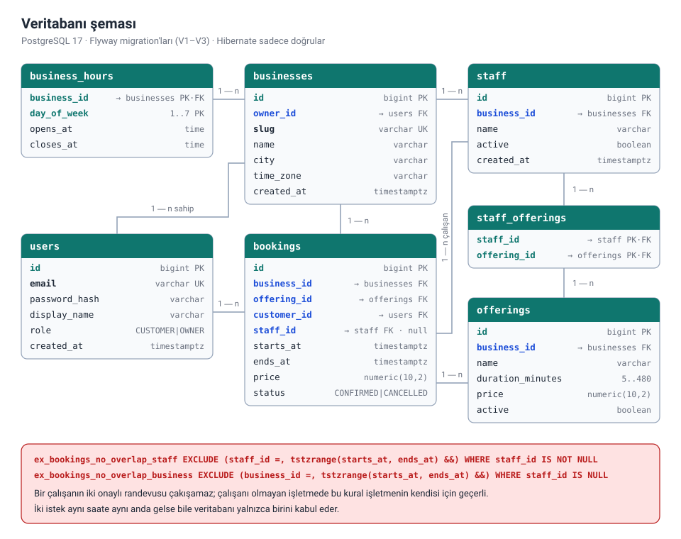
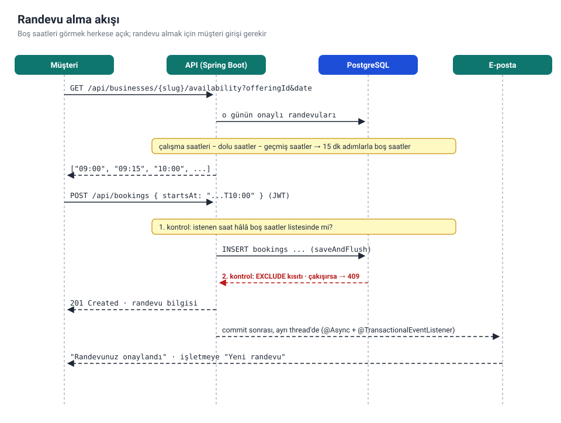
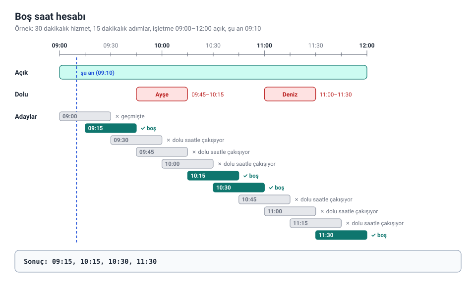

# randevu-api

[](https://github.com/Semiheren05/randevu-api/actions/workflows/ci.yml)


[](LICENSE)

Kuaför, klinik, güzellik salonu, özel ders gibi işletmeler için çok işletmeli bir **online randevu sistemi** backend'i. İşletmeler hizmetlerini ve çalışma saatlerini giriyor, müşteriler boş saatleri görüp randevu alıyor, iki taraf da e-posta ile haberdar oluyor.

Bu projeyi freelance platformlarındaki (Upwork, Freelancer) randevu ve rezervasyon sistemi ilanlarında en sık istenen özelliklere göre tasarladım: dinamik boş saatler, hizmet veren yönetimi, otomatik onay e-postaları ve işletme paneli istatistikleri.

## Teknolojiler

| Alan | Seçim |
|---|---|
| Dil / framework | Java 21, Spring Boot 3.5 |
| Güvenlik | Spring Security, durumsuz JWT, BCrypt, rol tabanlı yetkilendirme (`CUSTOMER`, `OWNER`) |
| Veritabanı | PostgreSQL 17, Spring Data JPA / Hibernate, Flyway, `EXCLUDE` kısıtı (btree_gist) |
| E-posta | Spring Mail (SMTP), olay tabanlı ve asenkron bildirim |
| API dokümantasyonu | OpenAPI 3 / Swagger UI (springdoc) |
| Test | JUnit 5, Mockito, AssertJ, Testcontainers |
| Dağıtım | Docker (multi-stage), Docker Compose, GitHub Actions |

## Özellikler

- **Çok işletmeli**: her işletme sahibi kendi işletmelerini yönetir; başkasının işletmesi ona hiç yokmuş gibi görünür (404)
- **Hizmetler ve çalışma saatleri**: süre ve fiyatıyla hizmetler, haftanın her günü için açılış/kapanış saati
- **Dinamik boş saatler**: çalışma saatlerinden onaylı randevular ve geçmiş saatler çıkarılır, kalanlar 15 dakikalık adımlarla sunulur
- **Çifte rezervasyon koruması**: iki aşamalı. Önce uygulama boş saatleri kontrol eder; aynı anda gelen iki istek bu kontrolü birlikte geçse bile PostgreSQL'in `EXCLUDE` kısıtı yalnızca birini kabul eder, diğeri `409` alır
- **İptal kuralları**: müşteri randevudan 2 saat öncesine kadar iptal edebilir; işletme sahibi yaklaşan her randevuyu iptal edebilir
- **E-posta bildirimleri**: randevu alındığında ve iptal edildiğinde müşteriye ve işletmeye Türkçe e-posta gider. Bildirim, kayıt kesinleştikten sonra ayrı bir thread'de gönderilir; mail sunucusu çökse bile randevu etkilenmez
- **İstatistikler**: seçilen dönemde onaylı ve iptal edilen randevu sayısı, gelir ve en çok tercih edilen hizmetler
- **Saat dilimi desteği**: zamanlar veritabanında UTC saklanır, API'de işletmenin kendi saat diliminde gösterilir
- **Tutarlı hata yanıtları**: her hata, 401/403 dahil, [RFC 9457](https://www.rfc-editor.org/rfc/rfc9457) problem-detail JSON'u olarak döner

## Nasıl çalışıyor?

### Veritabanı şeması



`bookings` tablosundaki `EXCLUDE` kısıtı projenin en önemli parçası. Aynı işletmenin iki onaylı randevusunun zaman aralıkları (`tstzrange`) kesişirse veritabanı ikinci kaydı reddediyor. Bu yüzden "önce kontrol et, sonra kaydet" arasındaki küçük boşlukta bile çifte rezervasyon oluşamıyor. `'[)'` sınırları sayesinde 10:00–10:30 ve 10:30–11:00 randevuları çakışmış sayılmıyor.

### Randevu alma akışı



### Boş saat hesabı



Hesap `AvailabilityCalculator` içinde, veritabanına ve saate dokunmayan saf bir fonksiyon. Bu sayede her kural (geçmiş saatler, çakışmalar, kapanışa sığmayan hizmetler, gece yarısını aşan saatler) birim testleriyle tek tek denenebiliyor.

## Çalıştırma

### Docker Compose ile (API + PostgreSQL)

```bash
cp .env.example .env
# .env içinde JWT_SECRET'ı ayarla, örneğin: openssl rand -base64 48
docker compose up --build
```

API `http://localhost:8080` adresinde, Swagger UI `http://localhost:8080/swagger-ui.html` adresinde açılır.

### IDE'den yerel olarak

```bash
docker compose up -d db     # sadece veritabanı
mvn spring-boot:run
```

`JWT_SECRET` ayarlanmazsa `application.yml` içindeki sadece geliştirme amaçlı anahtar kullanılır. Yerel geliştirme dışında buna asla güvenme.

### Ayarlar

| Değişken | Varsayılan | Amaç |
|---|---|---|
| `DB_URL` | `jdbc:postgresql://localhost:5432/randevuapi` | JDBC adresi |
| `DB_USERNAME` / `DB_PASSWORD` | `randevuapi` / `randevuapi` | Veritabanı bilgileri |
| `JWT_SECRET` | geliştirme değeri | Base64 HMAC anahtarı, en az 32 bayt |
| `JWT_EXPIRATION` | `1h` | Token geçerlilik süresi |
| `CORS_ALLOWED_ORIGINS` | `http://localhost:5500,http://localhost:3000` | İzinli tarayıcı adresleri |
| `BOOKING_SLOT_STEP` | `15m` | Boş saatlerin aralığı |
| `BOOKING_CANCELLATION_NOTICE` | `2h` | Müşterinin en geç ne kadar önce iptal edebileceği |
| `BOOKING_MAX_DAYS_AHEAD` | `60` | En fazla kaç gün sonrasına randevu alınabileceği |
| `SPRING_MAIL_HOST` / `SPRING_MAIL_PORT` | boş / `587` | SMTP sunucusu; host boşsa e-posta gönderilmez |
| `SPRING_MAIL_USERNAME` / `SPRING_MAIL_PASSWORD` | boş | SMTP giriş bilgileri |
| `NOTIFICATION_MAIL_FROM` | boş | Bildirimlerin gönderen adresi |

## API

| Metot | Yol | Erişim | Açıklama |
|---|---|---|---|
| `POST` | `/api/auth/register` | herkese açık | Hesap oluşturur (`role`: `CUSTOMER` ya da `OWNER`), token döner |
| `POST` | `/api/auth/login` | herkese açık | E-posta + şifre → token |
| `GET` | `/api/businesses?city=Istanbul` | herkese açık | İşletmeleri listeler (sayfalı) |
| `GET` | `/api/businesses/{slug}` | herkese açık | İşletme, çalışma saatleri ve aktif hizmetleri |
| `GET` | `/api/businesses/{slug}/availability?offeringId=1&date=2026-10-23` | herkese açık | O gün için boş saatler |
| `POST` | `/api/bookings` | `CUSTOMER` | Randevu al (201), saat doluysa 409 |
| `GET` | `/api/bookings` | `CUSTOMER` | Randevularım (sayfalı, en yeniler önce) |
| `POST` | `/api/bookings/{id}/cancel` | `CUSTOMER` | Randevumu iptal et |
| `POST` `GET` | `/api/owner/businesses` | `OWNER` | İşletme oluştur (201) / işletmelerim |
| `GET` `PUT` | `/api/owner/businesses/{id}` | `OWNER` | İşletmeyi getir / güncelle |
| `PUT` | `/api/owner/businesses/{id}/hours` | `OWNER` | Haftalık çalışma saatlerini değiştir |
| `POST` | `/api/owner/businesses/{id}/offerings` | `OWNER` | Hizmet ekle (201) |
| `PUT` `DELETE` | `/api/owner/businesses/{id}/offerings/{offeringId}` | `OWNER` | Hizmeti güncelle / pasifleştir (204) |
| `GET` | `/api/owner/businesses/{id}/bookings?date=2026-10-23` | `OWNER` | Günün randevuları, saat sırasıyla |
| `POST` | `/api/owner/businesses/{id}/bookings/{bookingId}/cancel` | `OWNER` | Randevuyu iptal et |
| `GET` | `/api/owner/businesses/{id}/stats?from=2026-10-01&to=2026-10-31` | `OWNER` | Dönem istatistikleri |
| `GET` | `/api/users/me` | giriş yapmış kullanıcı | Mevcut kullanıcı |

Örnek akış:

```bash
# 1. İşletme sahibi kaydolur, işletmesini ve hizmetini ekler
curl -X POST localhost:8080/api/owner/businesses \
  -H 'Authorization: Bearer <owner-token>' -H 'Content-Type: application/json' \
  -d '{"name":"Kuaför Ali","city":"Istanbul"}'
# {"id":1,"slug":"kuafor-ali",...}

# 2. Müşteri boş saatlere bakar (giriş gerekmez)
curl 'localhost:8080/api/businesses/kuafor-ali/availability?offeringId=1&date=2026-10-23'
# {"date":"2026-10-23","offeringId":1,"durationMinutes":30,"timeZone":"Europe/Istanbul","slots":["09:00","09:15",...]}

# 3. Müşteri randevu alır
curl -X POST localhost:8080/api/bookings \
  -H 'Authorization: Bearer <customer-token>' -H 'Content-Type: application/json' \
  -d '{"businessSlug":"kuafor-ali","offeringId":1,"startsAt":"2026-10-23T10:00"}'
# 201 {"id":1,"status":"CONFIRMED","startsAt":"2026-10-23T10:00:00",...}
```

Aynı saati ikinci kez almaya çalışan biri:

```json
{
  "type": "about:blank",
  "title": "Slot not available",
  "status": 409,
  "detail": "This time is not available, please choose another slot",
  "instance": "/api/bookings"
}
```

## Proje yapısı

```
src/main/java/com/semih/randevuapi
├── auth/        kayıt ve giriş
├── user/        kullanıcı entity'si, roller, /me
├── business/    işletmeler, çalışma saatleri, hizmetler; herkese açık ve işletme sahibi uç noktaları
├── booking/     boş saat hesabı, randevu alma/iptal, e-posta bildirimi, istatistikler
├── security/    JWT servisi ve filtresi, güvenlik ayarları, CORS, 401/403 yanıtları
├── common/      merkezi hata yönetimi, hata sınıfları, slug üretimi
└── config/      OpenAPI, web ve asenkron çalışma ayarları
src/main/resources/db/migration   Flyway SQL migration'ları
docs/                              README'deki diyagramlar
```

## Testler

```bash
mvn verify
```

- **Birim testleri**: boş saat hesabı (geçmiş saatler, çakışmalar, gece yarısı), randevu kuralları (iptal süresi, yarışı kaybeden istek), e-posta içerikleri, JWT ve kimlik doğrulama
- **Entegrasyon testleri**: Testcontainers ile gerçek bir PostgreSQL başlatılır (Docker gerekir; Docker yoksa atlanır). Testler baştan sona akışı dener: işletme kurma, boş saatler, randevu, iptal, istatistikler, rol ve sahiplik kontrolleri. Aynı saate **aynı anda** iki randevu isteği gönderip yalnızca birinin kabul edildiğini, bir de doğrudan SQL ile çakışan kayıt eklenemediğini doğrulayan testler var.

GitHub Actions her push'ta tüm testleri çalıştırıp Docker imajını derliyor.

## Yol haritası

- [x] İşletmeler, hizmetler, çalışma saatleri
- [x] Boş saat hesabı ve çifte rezervasyona karşı veritabanı kısıtı
- [x] E-posta bildirimleri ve işletme istatistikleri
- [ ] Çalışanlar: aynı işletmede birden fazla kişinin paralel randevu alabilmesi
- [ ] Tatil ve izin günleri (tek seferlik kapalı günler)
- [ ] Randevudan bir gün önce hatırlatma e-postası (`@Scheduled`)
- [ ] Online ödeme (Stripe / iyzico test modu)
- [ ] Müşteri yorumları ve puanlama

## Lisans

[MIT](LICENSE) © 2026 Semih Eren
